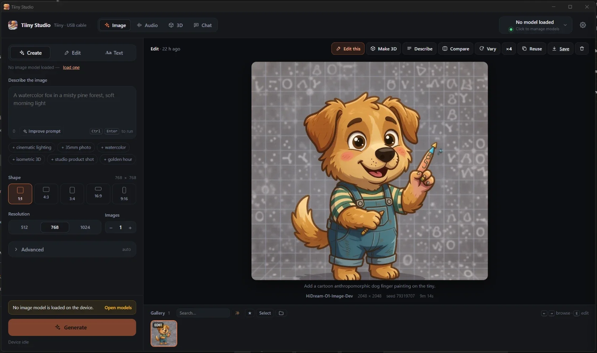
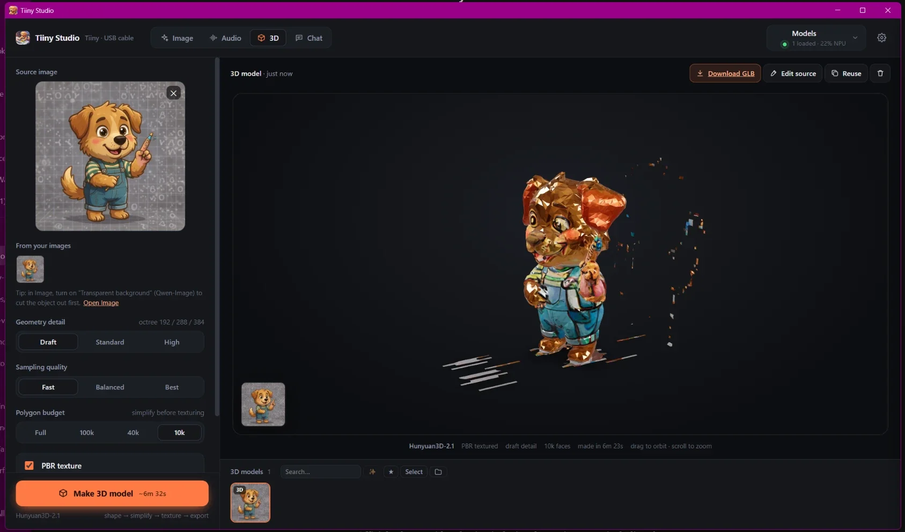
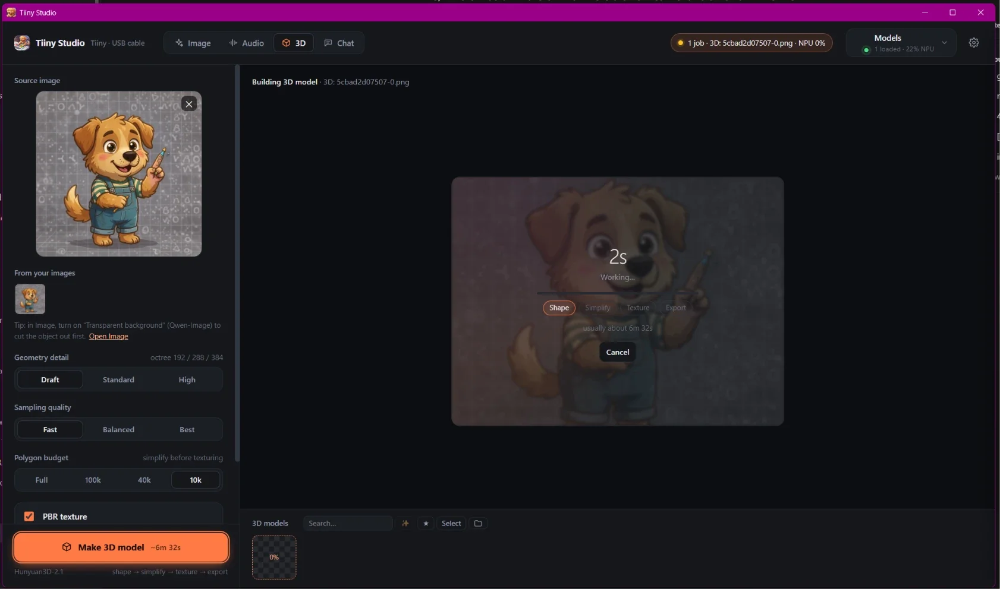
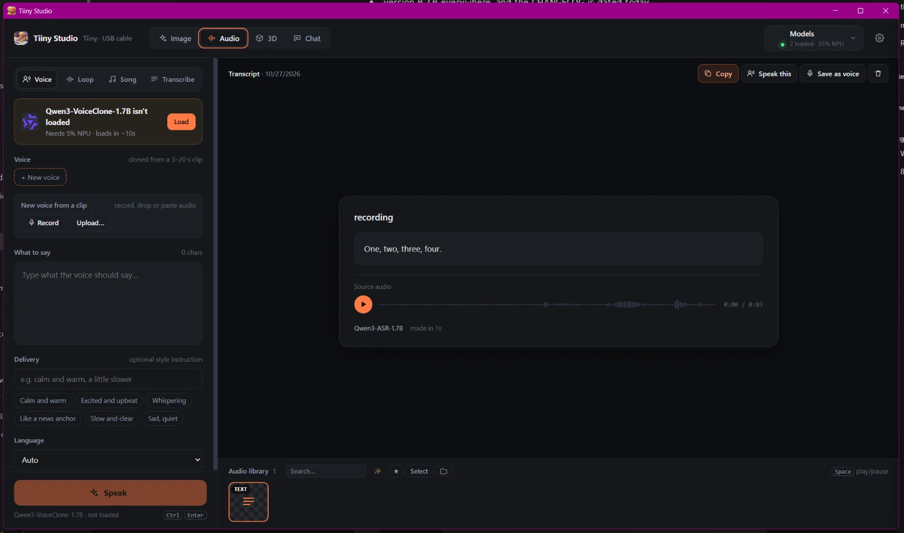
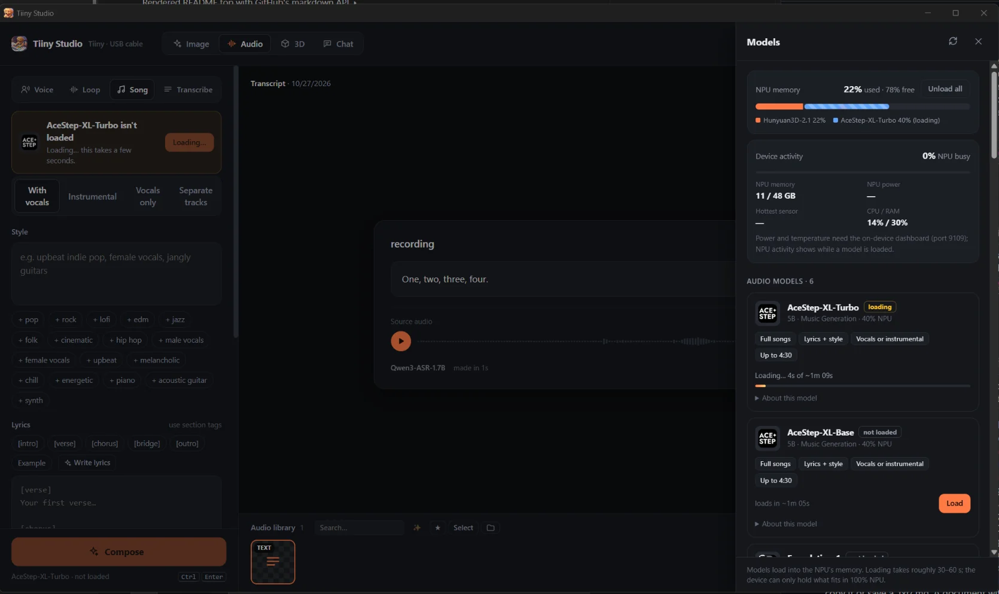
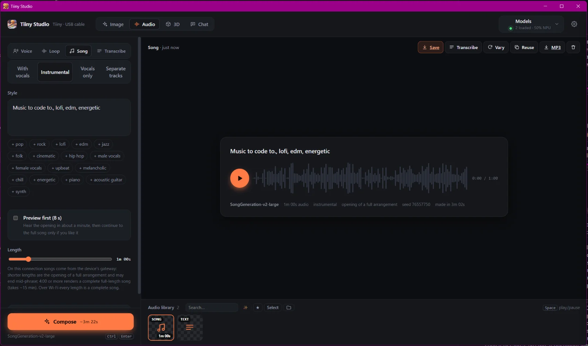

# Tiiny Studio

A local media studio for the **Tiiny Pocket** edge AI device: a desktop app for Windows, macOS and
Linux, or a small server for your home network (Docker). It drives the models on your Tiiny over your own network: create and edit images, clone voices, make music
loops and full songs, transcribe audio, and turn pictures into textured 3D models. Nothing leaves
your network.

Showcase and discussion: [Tiiny Studio on TiinyVerse](https://tiinyverse.com/posts/5abfe45c-3cf0-4f53-88ab-b397741702c3).

| | |
|---|---|
|  |  |
| **Image**: create and edit on the Tiiny (HiDream here) | **3D**: the same dog as a textured GLB, made in 6 minutes |
|  |  |
| **3D** while it builds: shape → simplify → texture → export | **Audio**: voices, loops, songs and transcription |
|  |  |
| **Models**: what's loaded, NPU memory and device activity | **Songs**: lyrics or instrumental, saved as WAV or MP3 |

- **Image**: create from a prompt; edit with plain-language instructions; circle an area to change;
  up to 10 reference images; transparent PNGs; before/after compare; ×4 variations shown as a grid;
  **Text** mode reads the text in pictures and documents you drop, paste or browse, or in a gallery
  image: photos, scans and screenshots (any format the browser opens, plus multi-page TIFF), PDF, Word,
  PowerPoint, Excel, OpenDocument, EPUB, RTF, HTML and plain text. Text that's already in a file is read
  directly; scanned pages and pictures inside documents go through OCR one page at a time, with progress
  and a Stop button (up to 50 pages per run). Show it as plain text or Markdown, which keeps headings,
  lists and tables from documents, gives pages, slides and sheets their own sections, and guesses PDF
  headings from font size (scans stay plain paragraphs); copy it or save a .txt/.md. A document with
  pictures saves as a .zip: the note plus an attachments/ folder, with each picture embedded where it
  was (unzip it into an Obsidian vault or any notes folder). Nothing is saved. OCR uses PP-OCRv6
  Small/Medium or GLM-OCR (GLM-OCR needs Wi-Fi/LAN because the gateway can't route it). Not supported:
  old binary Office files (.doc/.xls/.ppt) and iPhone HEIC photos.
- **Chat**: talk to the loaded model with streaming replies and an optional thinking view; attach
  pictures and documents; speak your message; and let it make things: create or edit images, read text
  aloud in your saved voice, make loops and song previews. When a tool needs a model that doesn't fit
  next to the chat model, the studio unloads the chat model, loads the tool's model, does the work, and
  loads the chat model back. Chats are saved in the studio's data folder (or not, if you switch that off) and
  each delete removes the conversation completely.
- **Audio**: voice cloning from a few seconds of speech (with a saved voice library, and long text
  voiced in parts and joined); tempo- and key-locked loops; full songs with lyrics, instrumental,
  vocals only or separate tracks, with an 8-second preview you can continue to the full song and an
  MP3 copy; transcription in 30 languages.
- **3D**: image → shape → simplify → PBR texture → GLB, with an interactive viewer. Cut the subject out first
  (Image → Edit, or Qwen-Image with a transparent background): Hunyuan3D builds the background too, as the
  floating shards around the dog above show.
- **Helpers** (when a chat model is loaded): improve a prompt, describe an image, write lyrics,
  suggest loop tags.
- **Gallery** (every workspace): search, smart search by meaning (the device's embedding model;
  vectors kept in memory only), ★ favorites, select several to delete or download as a zip.
- **Power off** the Tiiny from Settings (the same call the TiinyOS app makes).
- **Models panel**: load and unload any installed model (or all at once), see the NPU memory budget
  and live device activity (NPU busy %, memory, CPU/RAM; power and temperature too when the
  on-device dashboard on port 9109 runs), and get a prompt when something has to be unloaded.
- The UI adapts to each model's capabilities (for example, Edit is locked for create-only models),
  and remembers steps, guidance, size and negative prompt per image model.

It's written in Rust (one server library used by both the desktop app and the Docker image) with a vanilla-JS
front end. The original Python server is still in the repo as the behaviour reference the Rust version is tested
against.

## Install

Pick one. On first run the studio asks for your Tiiny's **address** and **API key**
([docs/CONNECTING.md](docs/CONNECTING.md) shows where TiinyOS lists them).

### 1. The desktop app (easiest: nothing else to install)

From the [Releases](../../releases) page, download the installer for your computer:

| your computer | file |
|---|---|
| Windows 10/11 | `Tiiny-Studio_<version>_x64-setup.exe` (or the `.msi`) |
| Windows 11 on ARM | `Tiiny-Studio_<version>_arm64-setup.exe` (or the `.msi`) |
| Mac with Apple Silicon (M1 and later) | `Tiiny-Studio_<version>_aarch64.dmg` |
| Mac with an Intel processor | `Tiiny-Studio_<version>_x64.dmg` |
| Linux (most PCs) | `Tiiny-Studio_<version>_amd64.deb` or `…_amd64.AppImage` |
| Linux on ARM (e.g. Raspberry Pi 5) | `Tiiny-Studio_<version>_arm64.deb` or `…_aarch64.AppImage` |

> **Tested so far:** only the **Windows x64** app and the **Docker** image (amd64) have been tested on real
> machines with a real Tiiny. The macOS, Linux and Windows ARM apps are built and smoke-tested automatically but
> haven't been tried by hand yet; reports are welcome (see [ROADMAP.md](ROADMAP.md)).

- **Windows:** run the setup (no admin rights needed; it installs for you only). The first time, Windows may
  say *"Windows protected your PC"* because the app isn't code-signed: click **More info → Run anyway**. Start
  it from the Start menu. To update, run a newer setup over it.
- **macOS:** open the `.dmg` and drag Tiiny Studio to Applications. The first time, right-click it → **Open** →
  **Open** (macOS asks because the app isn't notarized).
- **Linux:** `sudo apt install ./Tiiny-Studio_<version>_amd64.deb`, or make the AppImage executable
  (`chmod +x`) and run it. Needs WebKitGTK 4.1 (installed with most desktops).

The studio opens in its own window and puts an icon in the tray (open, results folder, start at login,
power off the Tiiny, quit). Only this computer can reach it. Your results and settings are kept in
`%APPDATA%\Tiiny Studio` (Windows), `~/Library/Application Support/Tiiny Studio` (macOS) or
`~/.local/share/tiiny-studio` (Linux). It works over every connection, the USB cable included.

### 2. Docker (a home server: use it from phones and other computers)

Install [Docker Desktop](https://www.docker.com/products/docker-desktop/) (Windows, macOS) or Docker
Engine with the Compose plugin (Linux). Download the source zip from Releases (or `git clone` this
repo), then in that folder:

```
docker compose up -d
```

Open <http://localhost:7860>. That pulls the prebuilt image (Intel and ARM). On Linux, run `mkdir data` first so
the files the studio saves belong to you. To update: `docker compose pull && docker compose up -d`. To build from
the source instead: `docker compose up -d --build`. To let other devices in, see [Configuration](#configuration).

USB note: if your Tiiny's USB address is `172.17.x.x`, Docker can't reach it (that's Docker's own
network); use the desktop app, or move Docker's network as the connection guide explains.

### 3. From source

The server: `cd rust && cargo run --release -p studio-server` (a current stable Rust), then open <http://localhost:7860>.
The desktop app: `cd rust/studio-desktop && cargo tauri build` (needs the Tauri CLI; on Linux, WebKitGTK).

The original Python server still runs as well (`python server.py`, Python 3.10+, no packages); it's kept as the
reference the Rust version is tested against. Data goes to `./data` either way.

## Configuration

| setting | where | notes |
|---|---|---|
| Devices (address + API key) | **Settings** (gear icon), saved to `data/config.json` | Save each way you reach your Tiiny (home Wi-Fi, phone hotspot, USB). With auto-switch on, the studio uses the first device in the list that answers (checked every 20 s) and comes back to a preferred one when it returns; a device you pick with **Use** stays until it stops answering. Each key is only sent to its own address and never to the browser. `TIINY_URL` / `TIINY_KEY` seed the first device. |
| `STUDIO_BIND` | `.env` (copy `.env.example`) | Who can open the studio. Default `127.0.0.1`, meaning only this computer. `0.0.0.0` opens it to your network. |
| `STUDIO_PASSWORD` | `.env` | Optional. Makes the browser ask for a password (any username). Set one if you open the studio to your network. |
| `PORT`, `DATA_DIR`, `HOST` | env | Default `7860`, `./data` (Docker: `/data`, mounted from `./data`) and, for native runs, `127.0.0.1`. |

**Network access is off by default.** Out of the box only the computer running the studio can open
it. To use it from a phone or another PC, put `STUDIO_BIND=0.0.0.0` and a `STUDIO_PASSWORD` in
`.env`, then `docker compose up -d` (for a native run, `HOST=0.0.0.0`). Settings shows which mode is
on, and warns if the network is open without a password. On Windows you may also need to allow
port 7860 through the firewall.

**Other websites can't use it.** The studio refuses changes sent from other web pages, and while network access is
off it only answers at `localhost`/`127.0.0.1`, so a page you visit can't reach it through a trick domain. If you put
the studio behind a reverse proxy or open it by a hostname, turn network access on (and set a password).

## Privacy

Everything the studio saves stays on your machine: results, prompts, sources and voices live only in
`data/`, and requests go only to your Tiiny.

- **Deleting a result removes all of it**: the gallery entry with its prompt and settings, the output
  and source files, the server's in-memory copy of the job, and the browser's copy (images are served
  with `Cache-Control: no-store`).
- **Settings → Delete everything** wipes every result, source, saved voice and saved chat in one step. Device
  settings are kept.
- **Documents are read in memory.** PDFs and TIFFs are opened in the browser; other documents are
  unpacked by the studio's server without being written to disk, and the text isn't stored anywhere.
- **Nothing is kept behind your back.** Typed text, lyrics and style drafts stay in the page's memory,
  not browser storage. Transcribing a voice clip for cloning is a throwaway job that's never saved.
  Server logs record request paths only, never prompts.
- **Your Tiiny keeps its own copy of chats.** Since TiinyOS 0.1.36 the Tiiny's vault (its memory service)
  stores every chat that goes through the device's gateway as full text, in one "conversation day" per day:
  prompts and replies from any app, this studio's chats and chat helpers included. The vault's memory scope
  setting doesn't change that. TiinyOS doesn't show these days, but you can delete one through the device's API
  (`DELETE /kb/conversation_days/{day}`); see [What your Tiiny keeps](docs/CONNECTING.md#what-your-tiiny-keeps)
  and the findings in [tiiny-api-notes](https://github.com/thezolon/tiiny-api-notes) (`docs/PRIVACY.md`).
- **Deleted files are overwritten with zeros before removal.** That's a best effort: SSDs and some
  file systems can keep old copies of the blocks, so for strong guarantees keep `data/` on an
  encrypted drive (for example BitLocker or FileVault).

## How it works

- **One job at a time.** The Tiiny serves one request at a time; running different models side
  by side just slows all of them (a 30 s song took 285 s next to a 3D job vs 96 s alone). Every
  job (image, audio, 3D, helper) waits in a single server-side queue and shows its place in line.
- **Jobs live on the server**, so a long song or 3D model keeps going if you reload or close the
  page. Results, voices and sources are stored in `data/` (`history.json`, `voices.json`, `images/`).
- **Works on Wi-Fi/LAN and USB.** Images, chat, transcription, voice cloning, OCR, 3D and music go
  through the device's gateway (port 80), which every connection exposes. Over USB the models' own
  ports are blocked, so songs come from the gateway's preview route (no separate tracks) and GLM-OCR
  is unavailable; the studio says so where it matters.

| file | what |
|---|---|
| `rust/studio-core/` | the server: routes, device client and settings, job queue, media jobs, chat and tools, documents, untrusted-content screening |
| `rust/studio-server/` | `tiiny-studio-server`, the headless server (Docker, home server) |
| `rust/studio-desktop/` | the desktop app (Tauri 2): window, tray, downloads, clipboard |
| `server.py`, `media.py`, `chat.py`, `extract.py`, `safety.py` | the original Python server, kept as the behaviour reference (`testdata/contract/` runs the same requests against both) |
| `static/index.html` | shell, Image workspace, Models panel |
| `static/settings.js` | device settings and first-run setup |
| `static/shared.js` | workspaces, job polling, model gating, audio helpers, waveform player |
| `static/audio.js`, `static/mesh.js` | Audio and 3D workspaces |
| `static/extras.js` | gallery tools, live device stats, OCR and documents in Text mode |
| `static/chat.js` | Chat workspace |
| `static/vendor/` | bundled for offline use: [`<model-viewer>`](https://modelviewer.dev) 3.5.0, [pdf.js](https://mozilla.github.io/pdf.js/) 4.10.38 with its CMaps, [UTIF.js](https://github.com/photopea/UTIF.js) 3.1.0 and pako 1.0.11 (TIFF) |
| `docs/CONNECTING.md` | finding the address and API key; USB notes; troubleshooting |
| `testdata/` | probe and smoke-test scripts used while building it (not in release packages) |
| `.github/workflows/release.yml` | on a `v*` tag: desktop installers for every OS, the source zip and the Docker image, attached to a GitHub release |
| `.github/workflows/rust.yml` | on every push: Rust tests, contract tests and document parity on Windows, macOS and Linux |
| `tools/api_snapshot.py` | snapshots the device's API specs into `docs/api/` and lists what changed after an update |
| `tools/release.py` | builds `dist/tiiny-studio-<version>.zip` from the committed tree (`--tag` also tags it) |

## Device APIs (TiinyOS 0.1.35, found by probing)

The full reference (every service, port and endpoint, marked tested/spec/docs) is in
[docs/DEVICE-API.md](docs/DEVICE-API.md); `tools/api_snapshot.py` rechecks it after a TiinyOS update.
The calls the studio relies on most:

Gateway on port 80, `Authorization: Bearer <API key>`:

| call | notes |
|---|---|
| `POST /v1/images/generations` | `model`, `prompt`, `n`, `size` (`WxH`), `negative_prompt`, `seed`, `steps`, `guidance_scale` (`cfg_scale` also accepted; `true_cfg_scale` is ignored), `response_format`, and `image` (base64/data URI) to **edit**, or `images` (an array, up to 10) for several references, with a model whose catalog entry has `supported: ["Image Editing"]`. `/v1/images/edits` and `/variations` don't exist. `n` above 1 fails ("batch_size other than 1 is not supported"), so the studio makes one request per image with consecutive seeds. |
| `POST /v1/chat/completions` | OpenAI format; images as `image_url` data URIs for models whose `input` includes `Image`. Disable thinking with `chat_template_kwargs: {"enable_thinking": false}` (gpt-oss rejects it; use `reasoning_effort`). |
| `POST /v1/audio/speech` | Voice clone: `model`, `input`, `ref_audio` (base64 WAV), `ref_text` (both required), `language`, `instruct`, `response_format` `wav`/`pcm`/`mp3`. The Base model only clones. |
| `POST /v1/audio/transcriptions` | Multipart `model`, `file`, `language`; `json`/`text` only. Returns nothing for 48 kHz stereo song mixes, so the studio resamples to 16 kHz mono. |
| `/v1/3d/*` | Proxy to Hunyuan3D: `/v1/3d/tasks` → its `/v1/tasks`. Multipart `stage` (`shape`, `simplify`, `texture`, `export`), `params` (JSON), files `image`/`mesh`/`material`; poll `GET /v1/3d/tasks/{id}`; cancel `POST …/cancel`. Shape ≈ 205 s (draft), texture ≈ 230 s, export ≈ 60 s. The `background` stage fails on the device (its BriefNet model is missing). |
| `GET /api/v1/models/?including_downloading=false` | Installed models: `status`, `type`, `input`, `supported`, `npu_usage` (% of NPU), `load_time`, `desc`. |
| `GET /api/v1/models/running` | Running instances with each container's `port`. |
| `GET /api/v1/models/{id}/unload_candidate` | Whether there's room for a model, and what to unload if not. |
| `POST /api/v1/models/{id}/launch` `{"model_id": id}` / `…/stop` | Load (async) / unload. `{id}` is URL-encoded. |

Music has gateway routes since Oct 2026 (`/v1/music/generate[/wav|/preview|/resume]`, `/v1/music/info`,
`/v1/music/sessions`), which work over USB too. The studio sends Foundation-1 loops through
`/v1/music/generate/wav` with its native body, and songs straight to the model's port when it's
reachable (complete song at exact length, separate tracks), else through `/preview` (+ `/resume` for
full-length). Plain `/v1/music/generate` fails for SongGeneration on TiinyOS 0.1.35. The models' own
ports (from `running`; no auth; not exposed over USB):

| model | call |
|---|---|
| Foundation-1 | `POST :port/v1/generate/wav {"prompt", "config": {seconds_total, steps, cfg_scale, seed}}` → WAV. Tag prompts; BPM 100–150; 4/8 bars; an 8 s loop takes ≈ 14 s. |
| SongGeneration-v2 | `POST :port/v1/generate {"config": {caption, lyrics, generation_type: mixed\|bgm, seconds_total, seed, steps, temperature, top_k, top_p, reference_audio_base64}}`. Only `config` is allowed at the top level; multi-line `[verse]`/`[chorus]` lyrics are sung; 30 s takes ≈ 96 s. |

## Keyboard

`Ctrl+Enter` run · `M` models · Image: `←/→` browse · `E` edit this · `V` vary · `R` reuse ·
`C` before/after · `D` download · Audio: `Space` play/pause · paste or drop files anywhere.
`Ctrl+V` goes to the drop zone under the pointer (or the one you last clicked), else the workspace's
main slot, and a toast says where it landed. Image drop zones also have a **Paste** button, handy on a
phone or tablet. Browsers only paste images that way, so for audio use `Ctrl+V`, drag-and-drop or Browse.

## Known device issues (TiinyOS 0.1.35)

- Hunyuan3D's `background` stage fails (its BriefNet model is missing), so cut the subject out first.
  The studio doesn't offer the stage.
- SongGeneration's style reference (`reference_audio_base64`) fails with `xh2a backend fail`, so the
  control is hidden (`SONG_STYLE_REF` in `static/audio.js`).
- There's no video generation yet: the import system has no video toolkit (Wan2.1 and LTX-Video
  inspect as `unsupported`), though the gateway already reserves `/v1/video/*`.

## Status

Version 0.2.0 (see [CHANGELOG.md](CHANGELOG.md)). An unofficial community project, not affiliated with
Tiiny. Tested against TiinyOS device services 0.1.35 and 0.1.36; device APIs may change with firmware updates
(`python tools/api_snapshot.py --check` shows what changed).

## License

Copyright 2026 [Zolon Farsane](https://github.com/thezolon). Licensed under the
[Apache License 2.0](LICENSE).

If you redistribute Tiiny Studio or a modified version, keep the [`NOTICE`](NOTICE) file with it
(Apache-2.0 §4d). It credits the original author and the bundled third-party code.
